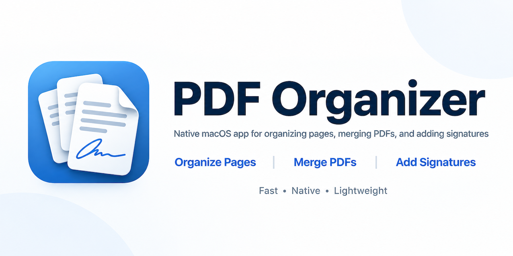

<p align="center">
  
</p>

# PDFolio

A lightweight, native macOS PDF app for the everyday parts of Acrobat: **organize pages**, **combine PDFs**, **read**, and **add a handwritten signature**. Fast, light on memory, local-only, and comfortable on a trackpad.

**Import PDFs → Organize Pages → Merge → Read → Add Signature → Export PDF**

Your source files stay unchanged: all edits apply to a page list that points into them, and the result is written when you export.

## Performance

PDFolio is designed to stay light on memory and responsive, including with thousands of pages and large scanned files.

Measured on an Apple Silicon MacBook (2560×1664 Retina, 4 performance cores), as the physical footprint Activity Monitor shows. The journal articles are JSTOR PDFs (scanned pages with a text layer). "Generated" pages each contain a JPEG photo, vector art and a paragraph of text. "Scanned" pages are unique A4 images at 300 dpi.

| Scenario | Target | Measured |
|---|---|---|
| Empty window, idle | 40–80 MB | **21 MB** |
| 5-page journal article (332 KB), loaded | 70–150 MB | **27 MB** (was 69 MB) |
| 59 pages from 3 journal articles, loaded | 70–150 MB | **30 MB** (was 97 MB) |
| Same 59 pages, scroll top → bottom → top | — | **peak 59 MB** (was 138 MB) |
| 999-page scanned PDF (28 MB), loaded | — | **30 MB** (was 57 MB) |
| Same 999 pages, scroll top → bottom → top | < 500–700 MB | **peak 38 MB** (was 128 MB) |
| Reading a 37-page scanned article | — | **~55 MB** settled, brief peak ~110 MB on entering reading mode |
| Add a 40-page scanned PDF: all visible thumbnails shown | responsive | **~120–200 ms** (was ~540 ms with a single render queue) |
| Export 1000 generated pages (default / flattened) | responsive | **0.9 s / 0.9 s**, footprint < 50 MB |
| Flattened export, 120 scanned pages (270 MB) | bounded | **288 MB** peak (was 759 MB, growing ~5.5 MB per page) |

How it stays light:

- The workspace stores **page references** (source, page index, rotation, signatures); page content stays in the source files. Page sizes and rotations are read once per file into a small table, so no parsed document stays open for the grid or the reader.
- **Freed memory goes back to the system.** Rendering a page allocates and frees multi-MB decode buffers, and the system allocator keeps freed large blocks for reuse (about 35 MB after one short article). The app turns that cache off at launch (`MallocLargeCache=0`), which can only be done from the environment, so `main` sets it and re-executes itself once.
- **Thumbnails are rendered in the display's color space.** For any other color space, sRGB included, Core Animation makes its own converted copy of every image on screen. Rendered for the display, the single copy is shared with the window server and no longer counts against the app, so the numbers above slightly understate what visible thumbnails cost the system as a whole. Moving the window to a display with a different profile re-renders them.
- **Thumbnails** render lazily, only for cells on screen, on a few parallel workers (one per performance core, up to 4). Each worker has its own documents. Requests for cells that scroll away are dropped before rendering. Sizes snap to buckets, images live in an `NSCache` budgeted at about three screens of thumbnails (8-48 MB), and rotation is a layer transform, so a rotated page reuses its existing thumbnail.
- **Reading mode** is a lightweight custom view that draws pages as vector content, only for the area on screen, from documents it opens on entry and releases on exit. Apple's `PDFView` was tried first, but it loads a machine-learning model and caches that are never freed: reading an 18-page, 259 KB journal article took the app to ~350 MB, rising to 677 MB after entering and leaving reading mode four times.
- The **signing view** also draws the page as vector content on demand, sized to what is on screen.
- PDFKit caches each drawn page's decoded images inside its document (tens of MB per scanned page), so the thumbnail workers, the reader and the exporter all release and reopen their documents periodically.
- **Export** streams page by page. The flattened path writes through a `CGPDFContext`, in chunks: the context holds data proportional to what it has written until it's closed, so large (scan-heavy) exports are written as several chunks and joined by copying pages. Normal documents fit in one chunk.
- Under memory pressure, all caches and parsed documents are dropped. They're recreated on demand.

## Features

### Organize and merge
- Drop any number of PDFs or images (PNG, JPEG, HEIC, …) into the window, the sidebar, or a gap between pages
- All pages appear in one thumbnail grid, from 1 to 16 pages per row (toolbar slider, pinch, or ⌘+ / ⌘−). At 1 per row each page fills the window. Each page is tagged with its file's color, so pages stay identifiable after mixing.
- Multi-select (click, ⇧/⌘-click, rubber band), then drag to reorder, including across files
- Rotate, duplicate and delete pages; insert a PDF or image after the selection (⇧⌘I); extract the selected pages into a new PDF (⇧⌘E)
- Right-click a page (or a selection) to read, sign, rotate, duplicate, extract, insert files after it, or delete
- Unlimited undo / redo for every page operation
- Password-protected PDFs prompt for their password

### Files sidebar
- Drag files to reorder them: each file's pages move as one block
- Click a file to select its pages
- Right-click a file to **remove it from the workspace** (or select it and press ⌫), read it, show it in Finder, export only that file, move it to the top or bottom, or restore pages you deleted from it. Removing is undoable, and the file on disk stays unchanged.

### Reading
- Double-click a page (or press Return) to read from there: pages are shown full width in a continuous scroll, exactly as they will export, with rotations and signatures applied
- Turn pages with ← / →, Page Up / Page Down, Home / End, the buttons at the bottom, or a two-finger swipe left / right. Pinch to zoom.
- The page on screen counts as the selection, so the toolbar's **Sign**, **Rotate** and **Delete** apply to it
- Press Esc, double-click the page again, or click **Pages** to go back to the grid, with the page you were reading selected

### Signatures
- Select a page and click **Sign** in the toolbar (⇧⌘S), in the grid or while reading
- Draw a signature with the mouse, or use **trackpad mode**: the trackpad surface maps onto the canvas and you sign with one finger, no clicking (like Preview). Press any key when done.
- Import a signature image. Transparent PNGs are used as-is. Photos or scans of ink on paper get the white background removed and margins trimmed automatically.
- Saved signatures are stored locally in `~/Library/Application Support/PDFolio/Signatures`
- Place a signature, then drag to move, drag a corner to resize (aspect locked) and use the arrow keys to nudge. Pinch to zoom the page.
- Signatures are attached to the page content, so rotating a signed page carries the signature with it

### Export
- Exports the current page sequence as one PDF (⌘E). Page content, fonts, text and images are copied as-is, so vector content stays vector and page sizes are preserved.
- By default, signatures are embedded as stamp annotations with a real appearance stream, so they show in every PDF reader
- **Flatten** option: bakes signatures and any existing annotations into the page content so they can't be moved or deleted. Links and form fields become static.
- Exports run in the background with progress and Cancel. They write to a temporary file first and replace the destination only when the export completes. Exporting over one of the imported source files is refused.

## Requirements

- macOS 14 or later
- Xcode Command Line Tools (`xcode-select --install`). Full Xcode is not required.

## Build

```bash
./build_app.sh
open PDFolio.app
```

This makes a release build, packages `PDFolio.app` with the icon and PDF/image document types (so Finder's **Open With** works), and ad-hoc signs it. Move it to `/Applications` to keep it.

You can also pass files on launch: `PDFolio.app/Contents/MacOS/PDFolio a.pdf b.pdf`.

## Checks

XCTest isn't usable with Command Line Tools alone, so the core logic is verified by a plain executable:

```bash
swift run -c release pdfolio-checks                       # all checks + 1000-page perf case
swift run -c release pdfolio-checks --skip-perf           # logic only
swift run -c release pdfolio-checks --perf-file big.pdf   # benchmark a real file
swift run -c release pdfolio-checks --skip-perf --flatten-only --perf-file scans.pdf  # flattened export only, in a fresh process
```

It covers:
- Page-list operations: move, remove, duplicate, rotate, insert, and file-level operations (regroup, remove, move to top/bottom, restore deleted pages)
- Rotation geometry
- Export in both modes, including a flattened export forced into many chunks. The output is rendered and checked by pixels: each signature must land in the right place and orientation, including on pre-rotated pages and pages rotated after signing.
- Text preservation, page sizes, source-file protection, cancellation and cleanup, image import, and signature cleanup

Two launch arguments help check the UI end to end:

- `--scroll-benchmark --quit <files…>`: scrolls the whole grid down and back up, prints peak memory, then quits
- `--read <files…>`: opens straight into reading mode, to measure its memory with `footprint`
- `--snapshot <dir> <files…>`: renders the main window, the signing sheet, the signature pad and reading mode to PNGs. This works without Screen Recording permission.

## Project layout

```
Sources/PDFolioCore     Model, page-list ops, geometry, export, thumbnail renderer (no UI)
Sources/PDFolio         AppKit app: window, page grid, files sidebar, reading mode, signing, signature pad
Sources/PDFolioChecks   Check runner and benchmarks
Resources               App icon and social preview
```

## Not in scope (for now)

Text/content editing, OCR, a full annotation suite, forms, cloud sync, AI features, and certificate-based digital signatures. The signature is a visual handwritten signature.

## Known limitations

- Reading mode doesn't support selecting text or clicking links yet
- Scanned PDFs use more memory (up to ~300 MB while reading or scrolling). That's a fixed-size system cache for decoding large images.
- Bookmarks/outlines from source PDFs are not carried into the exported file
- Flattening makes links and form fields non-interactive (that's what flattening means). The default export keeps them.

## License

PDFolio is licensed under the [GNU General Public License v3.0](LICENSE).
